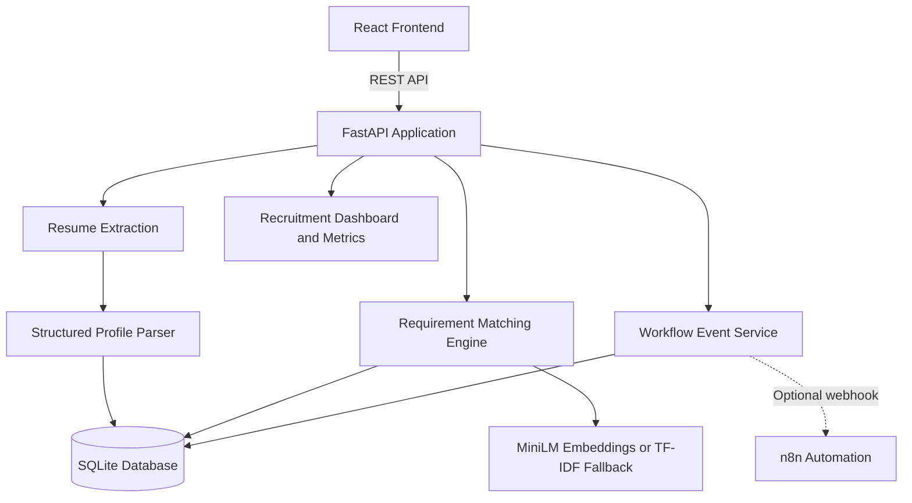

# TalentOps AI
### Evidence-Based Recruitment Intelligence and Workflow Automation

**TalentOps AI** is a recruitment intelligence platform that helps recruiters streamline resume screening, evaluate candidate-to-job alignment, and manage recruitment workflows through explainable AI-assisted analysis.

The platform combines resume parsing, semantic text matching, evidence-based requirement evaluation, candidate management, and workflow automation in one locally runnable application.

Its core principle is simple: **make candidate evaluation more transparent by showing the evidence behind every match, while keeping hiring decisions in human hands.**

> **Project status:** Working MVP with local AI-based text matching, resume processing, candidate management, and an optional n8n workflow integration. Some integrations and deployment capabilities remain future work.

<<<<<<< HEAD
## Features
- PDF / DOCX upload with type, magic-byte and size validation; extracted-text preview; clear errors (empty, corrupt, scanned PDFs)
- Rule-based structured profile (name, email, phone, skills, education, experience, projects, certifications) with warnings and *uncertain* flags
- Requirement-by-requirement matching: **matched / partial / insufficient evidence**, supporting text, coverage, transparent score
- Duplicate detection by normalized email (never silently overwrites; name/phone matches are warnings only)
- Review statuses: Pending Review, Shortlisted, Further Review Required (no auto-reject exists)
- Screening history, workflow event log, funnel metrics with explicit definitions
- **Ranking view** per job (review-priority order, ties share a rank, CSV export, bulk 'screen all')
- **Intent filter**: skills mentioned only as a plan/goal/negation ('planning to learn X') are not counted as evidence; they are shown, flagged, for human review
- **Two-way n8n automation**: outbound minimal events + inbound folder-watch resume intake with a protected API endpoint
- **Evaluation harness**: labelled synthetic set, keyword vs TF-IDF vs MiniLM, held-out test split
- Synthetic demo data loaded with one click
=======
## The Problem

Recruitment teams often process resumes in different formats, compare candidates against changing job requirements, and manually track screening decisions across multiple tools.

This creates several challenges:

- Extracting useful information from unstructured resumes.
- Identifying relevant skills when resumes and job descriptions use different wording.
- Explaining why a candidate appears to meet a particular requirement.
- Detecting duplicate candidate submissions.
- Maintaining consistent screening records and candidate pipeline visibility.
- Connecting screening activity to downstream recruitment workflows.

TalentOps AI explores how lightweight AI and workflow automation can address these challenges without relying on paid AI APIs or sending candidate resumes to external AI services.

## Key Features

### 1. Resume Ingestion and Parsing
- Upload PDF and DOCX resumes.
- Validate file types and file sizes.
- Extract resume text and preview the extracted content.
- Identify candidate information, including contact details, skills, education, experience, projects, and certifications where detectable.
- Display warnings when information is missing or extraction is uncertain.

### 2. Explainable Candidate-to-Job Matching
- Create job descriptions with required and preferred skills.
- Compare resume content with individual job requirements.
- Use local semantic embeddings to identify potentially relevant evidence beyond exact keyword matches.
- Classify requirements as **Matched**, **Partial**, or **Insufficient Evidence**.
- Display supporting resume text for individual matches.
- Calculate a transparent requirement-coverage score.

Semantic similarity is used as decision support, not as a prediction of hiring success. Missing evidence does not mean a candidate lacks a skill.

### 3. Candidate Management and Duplicate Detection
- Store candidate profiles and screening records in SQLite.
- Normalize email addresses for duplicate detection.
- Warn about possible duplicates without automatically merging records.
- Preserve screening history.
- Track candidate review status.

### 4. Recruitment Pipeline Dashboard
- View candidate records and screening activity.
- Track candidates by review status.
- Inspect screening history and workflow events.
- Monitor candidate pipeline counts and other explicitly defined metrics.
- Load synthetic demonstration data for testing the application.

### 5. Workflow Automation
- Optionally send screening events to an n8n webhook.
- Route events according to screening status.
- Record workflow delivery outcomes.
- Handle webhook failures without losing the underlying screening record.
- Send only the minimum information required for an event, rather than complete resumes or unnecessary personal details.

The core application remains usable when n8n is not configured or available.
>>>>>>> b36c59561d4d7a13a1b3d8e2a5f13b2598817a74

## Architecture



The application uses a single local FastAPI server rather than a distributed microservice architecture. The React frontend communicates with the API, which handles resume processing, matching, persistence, and workflow events.

The built frontend is included in `frontend/dist`, so Node.js is not required merely to run the application.

## Technology Stack

| Component | Technology |
|---|---|
| Frontend | React, Vite |
| Backend | Python, FastAPI |
| Data validation | Pydantic |
| Resume extraction | PyMuPDF, python-docx |
| Semantic matching | Sentence Transformers, `all-MiniLM-L6-v2` |
| Matching fallback | scikit-learn TF-IDF |
| Numerical operations | NumPy |
| Local persistence | SQLite |
| Workflow automation | Optional n8n webhook |
| Testing | pytest |
| Version control | Git and GitHub |

The AI model runs locally on the CPU. The application does not require a paid AI API, cloud LLM, GPU acceleration, Docker, or application deployment.

## Getting Started

### Prerequisites

- Windows 10 or a compatible operating system.
- Python 3.11 recommended.
- Git.
- VS Code, or another code editor.

Node.js is only required if you want to modify and rebuild the frontend.

### Installation

Clone the repository:

```powershell
git clone <your-repository-url>
cd talentops-ai
```

Create and activate a virtual environment:

```powershell
python -m venv .venv
.\.venv\Scripts\Activate.ps1
```

Install dependencies:

```powershell
python -m pip install --upgrade pip
pip install -r requirements.txt
```

Download the local embedding model:

```powershell
python scripts\download_model.py
```

This is a one-time download. If the model is unavailable, the application can fall back to TF-IDF matching, provided the fallback dependencies are installed.

Start the application:

```powershell
uvicorn app.main:app --port 8000
```

<<<<<<< HEAD
## Usage
1. Dashboard -> *Load synthetic demo data* (or **Upload resume** with files from `sample_data/resumes/`).
2. **Jobs** -> create a job (required/preferred skills, optional minimum experience).
3. **Candidates** -> open a candidate -> *Run screening* -> read the evidence -> set a review status.
4. **Ranking** tab -> pick a job -> *Screen all unscreened candidates* -> review order (a review-priority aid, not a decision) -> CSV export.
5. Re-upload `asha_verma_resubmission.pdf` after `asha_verma.pdf` to see duplicate detection.
=======
Open [http://127.0.0.1:8000](http://127.0.0.1:8000) in your browser.
>>>>>>> b36c59561d4d7a13a1b3d8e2a5f13b2598817a74

Select **Load synthetic demo data** to explore the application without using real candidate information.

### Running Tests

Run the automated test suite:

<<<<<<< HEAD
Embeddings vs TF-IDF: MiniLM maps text to dense vectors, so "trained classifiers" can be near "machine learning" without sharing words.
TF-IDF only weighs shared words, so it is more literal and misses paraphrases. The thresholds are **heuristic and uncalibrated**.
Cosine similarity is a similarity measure, **not a probability of hiring success**, and the score is **not a validated predictor of job performance**.

## Database design (SQLite)
- `candidates` - profile JSON, resume text, `email_normalized` with a **partial UNIQUE index** (only when an email exists)
- `jobs` - title, description, required/preferred skills, minimum experience
- `screenings` - append-only history per candidate x job; `review_status` guarded by a CHECK constraint
- `workflow_events` - audit log with n8n delivery status (`disabled` / `delivered` / `failed: ...`)

## Workflow automation design
On each screening and each human status change the app stores the event first, then POSTs
`{candidate_id, job_id, status, timestamp}` to `N8N_WEBHOOK_URL` (if set) with a short timeout. No name, email, phone or resume text is sent.
Two workflows live in `n8n/`:
- `01_outbound_screening_events.json` - app -> n8n (validate, route by status, build notice)
- `02_inbound_resume_intake.json` - folder -> n8n -> `POST /api/inbound/resume` (X-API-Key protected) -> parsed + screened as *Pending Review*

Full step-by-step setup, tests and troubleshooting: [`docs/N8N_SETUP.md`](docs/N8N_SETUP.md). The workflows are **generated files
that are not verified in a live n8n** until you complete that guide's checklist. No candidate message is ever sent; the only optional
external action is a Discord message to your own test channel.

## Evaluation
```powershell
python -m evaluation.build_dataset     # regenerate the synthetic labelled set (40 resumes, 4 jobs; deterministic)
python -m evaluation.run_eval          # writes evaluation/results/report.md and results.json
```
Protocol: resumes are split into DEV and TEST; the partial-match threshold is chosen on DEV and reported on TEST. Each
(resume, requirement) pair is labelled *has skill* (stated explicitly or paraphrased) or *no skill* (absent, or mentioned only
as a goal). The report compares keyword-only, TF-IDF, and MiniLM (when installed) on precision/recall/F1, recall on paraphrased
skills, false positives on goal-only mentions, and Spearman correlation between the score and the true coverage.

Findings from the first run (keyword + TF-IDF only; **MiniLM numbers must be produced on your machine**):
- Keyword matching flagged ~74% of 'planning to learn X' lines as evidence; the intent filter removed this on the synthetic set (optimistic: same author wrote cues and test sentences).
- Keyword and TF-IDF found essentially **none** of the paraphrased skills (recall ~0-4%). This is the case embeddings are meant to address.
- See `evaluation/results/report.md` for the full tables. The set is small and synthetic: it supports relative comparisons, not real-world accuracy claims.

## Testing
```powershell
python -m pytest -q
```
Tests (now including ranking, the inbound endpoint, the intent filter and the evaluation metrics) use small synthetic fixtures, need no network or API keys, and use the TF-IDF backend. One test exercises the MiniLM
backend and is **skipped automatically** if the model is not downloaded.

## Limitations
- No OCR: scanned/image-only PDFs are rejected with an explanatory error
- Rule-based parsing is heuristic: unusual layouts, multi-column resumes and non-English resumes may parse poorly; name detection is always "uncertain"
- Skill detection uses a small built-in lexicon plus the resume's skills section
- The intent filter is a hand-written cue list: it misses unusual phrasing and can wrongly exclude a genuine line (excluded lines are always shown to the recruiter)
- The evaluation set is synthetic and written by the matcher's author; no evaluation on real resumes has been done
- Experience years are only read from explicit statements like "3 years of experience"; dates are not computed
- Thresholds/weights are uncalibrated; no evaluation against labelled data has been done
- Single-user local app: no authentication, no multi-tenant access control, SQLite only
- Resume text is stored unencrypted in the local database
=======
```powershell
python -m pytest -q
```

The tests cover resume extraction, validation, candidate records, duplicate detection, matching logic, score calculations, and workflow handling. Model-specific test coverage depends on whether the embedding model is available.
>>>>>>> b36c59561d4d7a13a1b3d8e2a5f13b2598817a74

## How Matching Works

TalentOps AI evaluates each requirement against segments of the candidate's resume.

**Matched:** A relevant skill or recognized alias is found in the resume text.

**Partial:** A text segment appears semantically relevant, but the evidence requires human confirmation.

**Insufficient Evidence:** The system cannot identify sufficient supporting text for the requirement.

The application calculates a coverage score using the following formula:

\[
\text{Score} = 100 \times (0.8R + 0.2P)
\]

Where:

- \(R\) is the proportion of required-skill coverage.
- \(P\) is the proportion of preferred-skill coverage.
- Matched requirements contribute 1, partial matches contribute 0.5, and insufficient evidence contributes 0.

If only one requirement group is present, that group receives full weight.

The score weights and similarity thresholds are heuristic and have not been calibrated against labelled recruitment data. The score is not a probability of hiring success or a validated measure of future job performance.

## Data Model

The local SQLite database contains the main records needed to support the recruitment workflow:

- **Candidates:** Structured profiles, normalized email addresses, and extracted resume text.
- **Jobs:** Job titles, descriptions, required skills, preferred skills, and optional experience requirements.
- **Screenings:** Candidate-to-job evaluations, review status, and screening history.
- **Workflow events:** Event records and webhook delivery outcomes.

Database constraints help prevent duplicate email records and invalid review statuses.

## Workflow Automation

When screening activity or a human review-status change generates an event, the application records the event locally and can optionally send a webhook request to n8n.

The payload contains only the fields needed for workflow routing, such as candidate ID, job ID, screening status, and timestamp.

The n8n workflow can be imported using the instructions in [`docs/N8N_SETUP.md`](docs/N8N_SETUP.md).

**Integration status:** The workflow definition is provided as part of the project. Treat the n8n integration as unverified until it has been imported and tested in a running n8n instance.

## Testing and Validation

The project includes automated tests for:

- PDF and DOCX extraction.
- Empty, invalid, and oversized files.
- Candidate profile validation.
- Email normalization and duplicate detection.
- Database persistence.
- Requirement matching and missing-evidence handling.
- Match-score calculations.
- Workflow payload construction.
- Webhook failures and timeouts.

Tests use synthetic fixtures and do not require paid APIs or external AI services.

## Responsible AI and Privacy

TalentOps AI is designed to support recruiters, not replace their judgment.

- **Human review:** The application does not automatically reject candidates.
- **Evidence-based evaluation:** Matching results include supporting resume text where available.
- **Transparent uncertainty:** Missing evidence is not treated as proof that a candidate lacks a skill.
- **Requirement-focused matching:** Candidate names, contact details, photographs, and demographic attributes are not intended to influence match scores.
- **Controlled duplicate handling:** Potential duplicates are flagged rather than automatically merged.
- **Data minimization:** Optional webhook events exclude complete resumes and unnecessary personal information.
- **Local processing:** Resume analysis does not require sending resume text to a paid or cloud AI API.

The current MVP is intended for local experimentation with synthetic data, not for production use with real candidate records.

## Current Limitations

- Scanned image-only PDFs are not supported because OCR is not implemented.
- Resume parsing relies on rules and heuristics, which may perform poorly on unusual layouts, multi-column resumes, or non-English documents.
- Name extraction is uncertain and may require manual correction.
- Experience is extracted from explicit statements rather than comprehensively calculated from employment dates.
- Matching thresholds and score weights have not been calibrated against labelled data.
- The application has not undergone a formal fairness or predictive-validity evaluation.
- The current version is a single-user local application without authentication or multi-tenant access control.
- Resume text is stored in the local database without encryption.
- Live n8n integration must be verified separately.

## Future Improvements

Potential next steps include:

- OCR for scanned resumes.
- More robust resume section and experience extraction.
- Configurable job-specific matching rules.
- Evaluation against labelled resume-to-job examples.
- Fairness testing and additional audit controls.
- Authentication, role-based access, and data retention tools.
- More recruitment-system integrations.
- Expanded workflow automation and notification options.
- Additional dashboard filters and recruiter reporting.

## Screenshots

Add screenshots of the running application to `docs/screenshots/` as the interface is validated.

Suggested screenshots:

- `dashboard.png`
- `resume-upload.png`
- `candidate-match-evidence.png`
- `candidate-pipeline.png`

## Project Goals

TalentOps AI explores how lightweight semantic AI, explainable matching, structured data management, and workflow automation can work together to make recruitment screening more transparent and easier to manage.

The emphasis is on practical implementation, traceable evidence, responsible use of AI, and a modular architecture that can be extended as the project evolves.
