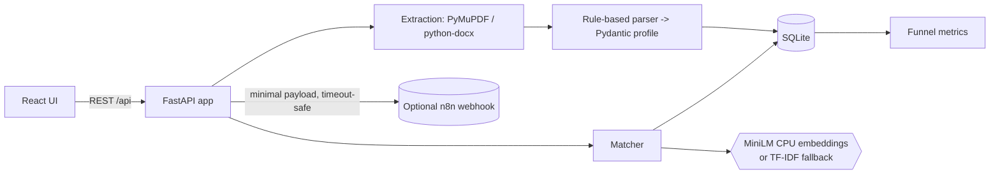

# TalentOps AI

**Evidence-Based Recruitment Intelligence and Workflow Automation**
*From resume ingestion to explainable candidate matching and recruitment workflow automation.*

A local-first MVP built for an AI-intern placement drive. It ingests PDF/DOCX resumes, builds structured candidate
profiles, matches them to job descriptions **with the resume text that supports each result**, detects duplicate
candidates, tracks a review pipeline, and can optionally emit minimal events to an n8n webhook.

> This is a student MVP using **synthetic data only**. It is not production-ready, has no enterprise integrations, and
> no business impact has been measured. All outputs are decision *support*; a human recruiter reviews every candidate.

## Business problem
Recruiters screen large resume volumes in mixed formats, re-screen the same people, and struggle to explain why a
candidate was shortlisted. TalentOps AI demonstrates a transparent alternative: show *which requirement* is supported
by *which resume line*, say clearly when evidence is missing, and keep the human in charge.

## Features
- PDF / DOCX upload with type, magic-byte and size validation; extracted-text preview; clear errors (empty, corrupt, scanned PDFs)
- Rule-based structured profile (name, email, phone, skills, education, experience, projects, certifications) with warnings and *uncertain* flags
- Requirement-by-requirement matching: **matched / partial / insufficient evidence**, supporting text, coverage, transparent score
- Duplicate detection by normalized email (never silently overwrites; name/phone matches are warnings only)
- Review statuses: Pending Review, Shortlisted, Further Review Required (no auto-reject exists)
- Screening history, workflow event log, funnel metrics with explicit definitions
- **Ranking view** per job (review-priority order, ties share a rank, CSV export, bulk 'screen all')
- **Intent filter**: skills mentioned only as a plan/goal/negation ('planning to learn X') are not counted as evidence; they are shown, flagged, for human review
- **Two-way n8n automation**: outbound minimal events + inbound folder-watch resume intake with a protected API endpoint
- **Evaluation harness**: labelled synthetic set, keyword vs TF-IDF vs MiniLM, held-out test split
- Synthetic demo data loaded with one click

## Architecture

Why a small API server at all? A browser UI cannot run PyMuPDF/SQLite, so the React UI talks to one local FastAPI
process (no microservices). The built UI is committed in `frontend/dist`, so **Node.js is not needed to run the app**.

## Tech stack
Python 3.11, FastAPI, Pydantic, SQLite, PyMuPDF, python-docx, Sentence Transformers (`all-MiniLM-L6-v2`, CPU),
scikit-learn, NumPy, React (Vite), pytest, requests. No paid API, no cloud LLM, no GPU, no Docker.

## Installation (Windows 10, PowerShell)
Prerequisites: [Python 3.11](https://www.python.org/downloads/windows/) (tick "Add python.exe to PATH"),
[Git](https://git-scm.com/download/win), [VS Code](https://code.visualstudio.com/). Node.js is only needed to modify the UI.
```powershell
git clone <your-repo-url> talentops-ai
cd talentops-ai
python --version                      # expect 3.11.x
python -m venv .venv
.\.venv\Scripts\Activate.ps1          # if blocked: Set-ExecutionPolicy -Scope CurrentUser RemoteSigned
python -m pip install --upgrade pip
pip install -r requirements.txt       # CPU PyTorch is the default on Windows PyPI
python scripts\download_model.py      # one-time ~90 MB; optional - app falls back to TF-IDF without it
uvicorn app.main:app --port 8000
```
Open http://127.0.0.1:8000 and click **Load synthetic demo data**.

## Usage
1. Dashboard -> *Load synthetic demo data* (or **Upload resume** with files from `sample_data/resumes/`).
2. **Jobs** -> create a job (required/preferred skills, optional minimum experience).
3. **Candidates** -> open a candidate -> *Run screening* -> read the evidence -> set a review status.
4. **Ranking** tab -> pick a job -> *Screen all unscreened candidates* -> review order (a review-priority aid, not a decision) -> CSV export.
5. Re-upload `asha_verma_resubmission.pdf` after `asha_verma.pdf` to see duplicate detection.

Developing the UI: `cd frontend; npm install; npm run dev` (port 5173, proxies to 8000); `npm run build` refreshes `dist`.
Regenerate sample files: `python scripts\generate_samples.py`.

## Matching methodology
For each requirement the matcher looks for evidence in resume segments (lines/sentences):
1. **Matched** - the skill term or a known alias appears as a whole word in a resume segment (e.g. `sklearn` = scikit-learn; `Java` does not match `JavaScript`).
2. **Partial** - no keyword hit, but a segment is semantically similar (cosine similarity >= threshold: 0.45 for MiniLM, 0.20 for TF-IDF). Semantic-only evidence is capped at *partial* so a human confirms it.
3. **Insufficient evidence** - nothing found. This does **not** mean the candidate lacks the skill.

**Score** = 100 x (0.8 x required coverage + 0.2 x preferred coverage); matched = 1, partial = 0.5, insufficient = 0.
If only one group exists it carries full weight. Minimum experience (self-declared in the resume) and whole-description
similarity are displayed but excluded from the score.

Embeddings vs TF-IDF: MiniLM maps text to dense vectors, so "trained classifiers" can be near "machine learning" without sharing words.
TF-IDF only weighs shared words, so it is more literal and misses paraphrases. The thresholds are **heuristic and uncalibrated**.
Cosine similarity is a similarity measure, **not a probability of hiring success**, and the score is **not a validated predictor of job performance**.

## Database design (SQLite)
- `candidates` - profile JSON, resume text, `email_normalized` with a **partial UNIQUE index** (only when an email exists)
- `jobs` - title, description, required/preferred skills, minimum experience
- `screenings` - append-only history per candidate x job; `review_status` guarded by a CHECK constraint
- `workflow_events` - audit log with n8n delivery status (`disabled` / `delivered` / `failed: ...`)

## Workflow automation design
On each screening and each human status change the app stores the event first, then POSTs
`{candidate_id, job_id, status, timestamp}` to `N8N_WEBHOOK_URL` (if set) with a short timeout. No name, email, phone or resume text is sent.
Two workflows live in `n8n/`:
- `01_outbound_screening_events.json` - app -> n8n (validate, route by status, build notice)
- `02_inbound_resume_intake.json` - folder -> n8n -> `POST /api/inbound/resume` (X-API-Key protected) -> parsed + screened as *Pending Review*

Full step-by-step setup, tests and troubleshooting: [`docs/N8N_SETUP.md`](docs/N8N_SETUP.md). The workflows are **generated files
that are not verified in a live n8n** until you complete that guide's checklist. No candidate message is ever sent; the only optional
external action is a Discord message to your own test channel.

## Evaluation
```powershell
python -m evaluation.build_dataset     # regenerate the synthetic labelled set (40 resumes, 4 jobs; deterministic)
python -m evaluation.run_eval          # writes evaluation/results/report.md and results.json
```
Protocol: resumes are split into DEV and TEST; the partial-match threshold is chosen on DEV and reported on TEST. Each
(resume, requirement) pair is labelled *has skill* (stated explicitly or paraphrased) or *no skill* (absent, or mentioned only
as a goal). The report compares keyword-only, TF-IDF, and MiniLM (when installed) on precision/recall/F1, recall on paraphrased
skills, false positives on goal-only mentions, and Spearman correlation between the score and the true coverage.

Findings from the first run (keyword + TF-IDF only; **MiniLM numbers must be produced on your machine**):
- Keyword matching flagged ~74% of 'planning to learn X' lines as evidence; the intent filter removed this on the synthetic set (optimistic: same author wrote cues and test sentences).
- Keyword and TF-IDF found essentially **none** of the paraphrased skills (recall ~0-4%). This is the case embeddings are meant to address.
- See `evaluation/results/report.md` for the full tables. The set is small and synthetic: it supports relative comparisons, not real-world accuracy claims.

## Testing
```powershell
python -m pytest -q
```
Tests (now including ranking, the inbound endpoint, the intent filter and the evaluation metrics) use small synthetic fixtures, need no network or API keys, and use the TF-IDF backend. One test exercises the MiniLM
backend and is **skipped automatically** if the model is not downloaded.

## Limitations
- No OCR: scanned/image-only PDFs are rejected with an explanatory error
- Rule-based parsing is heuristic: unusual layouts, multi-column resumes and non-English resumes may parse poorly; name detection is always "uncertain"
- Skill detection uses a small built-in lexicon plus the resume's skills section
- The intent filter is a hand-written cue list: it misses unusual phrasing and can wrongly exclude a genuine line (excluded lines are always shown to the recruiter)
- The evaluation set is synthetic and written by the matcher's author; no evaluation on real resumes has been done
- Experience years are only read from explicit statements like "3 years of experience"; dates are not computed
- Thresholds/weights are uncalibrated; no evaluation against labelled data has been done
- Single-user local app: no authentication, no multi-tenant access control, SQLite only
- Resume text is stored unencrypted in the local database

## Responsible AI safeguards
- Human-in-the-loop: no automatic rejection or ranking cut-off; statuses are set by a person
- Missing evidence is reported as "insufficient evidence", never as proof of absence
- Scoring uses only requirement evidence - not name, contact details, photos or demographics (covered by a test)
- Duplicates are never auto-merged and never overwritten; fuzzy matches are warnings
- Minimal data leaves the app (webhook payload); no external AI service sees resumes
- Synthetic sample data only; `.gitignore` blocks databases, `.env` and model weights

## Future improvements
OCR for scanned PDFs, local-LLM parser behind the same `parse_resume` interface, calibrated thresholds with labelled data,
bias/fairness audits, authentication and roles, data retention/deletion tools, ranking views with human override logs.

## Screenshots
_Add after running the app:_ `docs/screenshots/dashboard.png`, `upload.png`, `evidence.png`.
