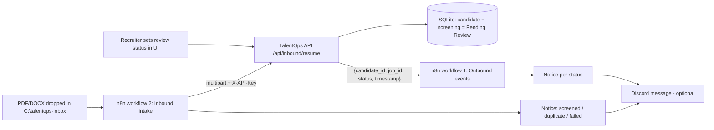

# n8n integration: exact setup and test steps

TalentOps AI uses n8n in **both directions**. The app works fully without n8n; everything here is optional.



| Workflow file | Direction | What it automates |
|---|---|---|
| `n8n/02_inbound_resume_intake.json` | folder -> n8n -> app | Detects a new resume file, sends it to the app, which parses + screens it; n8n then builds a notice (screened / duplicate / failed) |
| `n8n/01_outbound_screening_events.json` | app -> n8n | Receives minimum-necessary events, validates them, routes by status, builds a notice |

> **Status honesty.** The two workflow files were generated by `scripts/build_n8n_workflows.py`. Their JSON is valid,
> the validation JavaScript was run in Node, and the app's `/api/inbound/resume` endpoint was exercised with the same
> multipart request n8n sends (pytest + curl). **The workflows themselves have not been imported into a live n8n by the
> author.** Treat them as "tested" only after you tick the checklist at the bottom. If a node shows a parameter error
> after import, fix it in the n8n UI (n8n versions change node fields) and tell me the message.

No emails or WhatsApp messages are sent. The only external action is an optional **Discord** message to *your own* test channel.

---
## Step 1 - Install and start n8n (no Docker)
1. Install the current **LTS** Node.js from https://nodejs.org/ (n8n tells you if the version is unsupported).
2. In a **new PowerShell window**:
```powershell
node --version
npx n8n
```
First run downloads n8n (a few minutes). When you see `Editor is now accessible via: http://localhost:5678`, open it and create the local owner account. Keep this window open.

## Step 2 - Prepare TalentOps AI (a second PowerShell window, in the repo, venv active)
```powershell
python -c "import secrets; print(secrets.token_urlsafe(24))"     # copy this token
Copy-Item .env.example .env
notepad .env
```
In `.env` set (paste your token):
```
TALENTOPS_INBOUND_TOKEN=<your token>
N8N_WEBHOOK_URL=http://127.0.0.1:5678/webhook/talentops-screening
```
Start the app and load demo data:
```powershell
uvicorn app.main:app --port 8000
```
Open http://127.0.0.1:8000 -> **Load synthetic demo data**. Note the job's ID on the **Jobs** tab (the demo job is `1`).

## Step 3 - Test the inbound endpoint WITHOUT n8n first (third PowerShell window)
```powershell
curl.exe -X POST http://127.0.0.1:8000/api/inbound/resume -H "X-API-Key: <your token>" -F "file=@sample_data\resumes\priya_nair.pdf" -F "job_id=1"
```
Expected: JSON with `candidate_id`, `score`, `counts`, `review_status: Pending Review`. A wrong key gives `401`. If this fails, fix it before touching n8n.

## Step 4 - Import and test workflow 1 (outbound)
1. n8n -> **Workflows** -> menu -> **Import from file** -> `n8n/01_outbound_screening_events.json`.
2. Open **Screening Webhook** -> click **Listen for test event** (it uses the `webhook-test` URL).
3. Test with PowerShell:
```powershell
$body = @{ candidate_id = 1; job_id = 1; status = "Shortlisted"; timestamp = (Get-Date).ToUniversalTime().ToString("o") } | ConvertTo-Json
Invoke-RestMethod -Method Post -Uri "http://127.0.0.1:5678/webhook-test/talentops-screening" -ContentType "application/json" -Body $body
```
Expected: `received: True`, and the canvas highlights *Prepare Shortlisted Notice*.
4. Extra-field rejection (personal data is refused on purpose):
```powershell
$bad = @{ candidate_id = 1; job_id = 1; status = "Shortlisted"; timestamp = (Get-Date).ToUniversalTime().ToString("o"); email = "x@example.com" } | ConvertTo-Json
Invoke-RestMethod -Method Post -Uri "http://127.0.0.1:5678/webhook-test/talentops-screening" -ContentType "application/json" -Body $bad
```
Expected: HTTP 400 (PowerShell shows an error; the n8n canvas shows the *Respond 400* path).
5. For the app to reach it automatically, **activate** the workflow (toggle top-right). The app uses the *production* URL (`/webhook/...`) from `.env`.
6. In the TalentOps UI open a candidate, run a screening and change the review status. Under **Workflow event history** the `n8n delivery` column should read `delivered`.
7. Stop n8n (Ctrl+C) and change a status again: it reads `failed: ...` but the status change is still saved.

## Step 5 - Import and test workflow 2 (inbound)
1. Create the inbox folder: `mkdir C:\talentops-inbox`
2. Import `n8n/02_inbound_resume_intake.json`.
3. Open **Send To TalentOps API** and set: header `X-API-Key` = your token; body parameter `job_id` = your job ID.
4. Open **Watch Resume Inbox Folder** and confirm the path is `C:\talentops-inbox`.
5. Click **Execute workflow** (n8n now listens), then copy a sample resume in:
```powershell
Copy-Item sample_data\resumes\rohan_mehta.docx C:\talentops-inbox\
```
6. Expected in n8n: all nodes green, *Prepare Review Notice* output reads like `[TEST ONLY] New resume screened: candidate #N ... Awaiting HUMAN review`.
   Expected in TalentOps: a new candidate (stage *Screened*) and a *Pending Review* screening; also visible in the **Ranking** tab.
7. Drop `asha_verma_resubmission.pdf` after `asha_verma.pdf` -> *Prepare Duplicate Notice* fires and no second candidate is created.
8. Drop a `.txt` file -> *Prepare Failure Notice* (the app returns 422: only PDF/DOCX).
9. For unattended use, **activate** the workflow (n8n and the app must both stay running).

## Step 6 - Optional real notification (Discord, free)
1. In a Discord server you own: Server Settings -> Integrations -> Webhooks -> New Webhook -> **Copy Webhook URL**.
2. In either workflow open **Send Discord Message (optional)**, paste the URL, and enable the node (the "disable" toggle).
3. Repeat Step 5.5 / Step 4.3: a message appears in your channel. Use only synthetic data. Never put real candidate details in a notification.

## Troubleshooting
| Symptom | Fix |
|---|---|
| `curl.exe` returns 503 | `TALENTOPS_INBOUND_TOKEN` is empty in `.env`, or the app was not restarted after editing it |
| 401 from the API | The `X-API-Key` header differs from the token in `.env` |
| n8n *Send To TalentOps API* shows connection refused | Start `uvicorn`; use `127.0.0.1`, not `localhost` (IPv6 can interfere on Windows) |
| Folder trigger never fires | Click **Execute workflow** (test) or activate the workflow; confirm the exact folder path; copy the file in AFTER the trigger is listening |
| Webhook returns 404 | Test URL only works while "Listen for test event" is active; the production URL needs the workflow **Active** |
| App shows `failed: HTTP 404` on delivery | `.env` points at `/webhook/...` but the workflow is inactive |
| Node shows a red parameter error after import | n8n node fields differ by version: re-select the option in the UI and save; report the message |
| 422 `No readable text` | Scanned/image-only PDF: OCR is not supported |

## Verification checklist (tick before claiming "tested integration")
- [ ] Step 3 curl returned a screening JSON
- [ ] Workflow 1: valid payload -> 200 and correct route for all three statuses
- [ ] Workflow 1: extra-field payload -> 400
- [ ] App showed `delivered` with n8n active, and `failed` (record still saved) with n8n stopped
- [ ] Workflow 2: new file -> candidate + Pending Review screening created
- [ ] Workflow 2: duplicate file -> duplicate notice, no second candidate
- [ ] Workflow 2: `.txt` file -> failure notice
- [ ] (Optional) Discord message received
